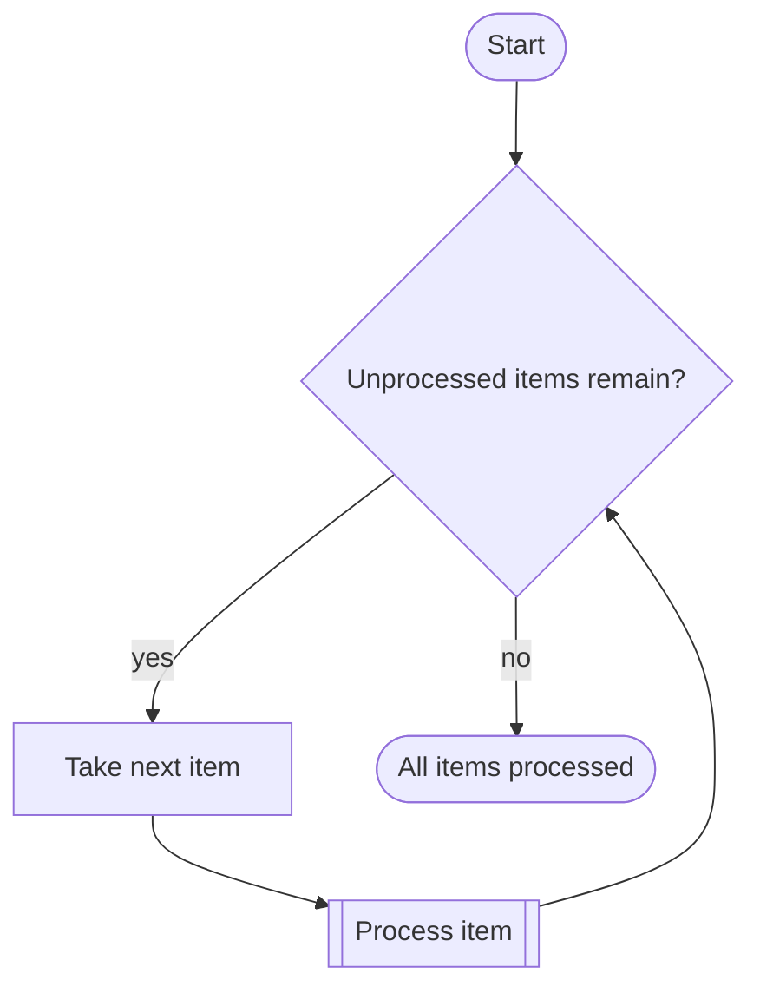
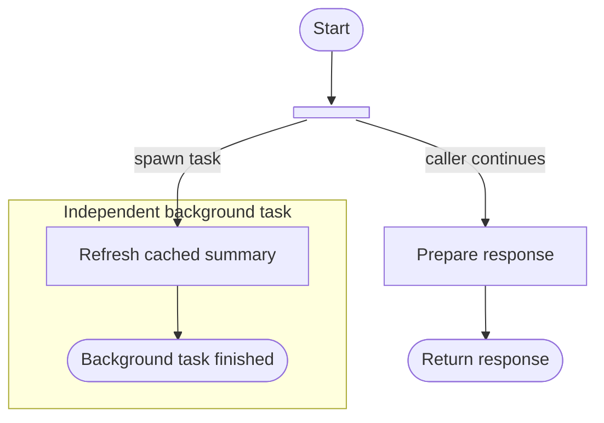
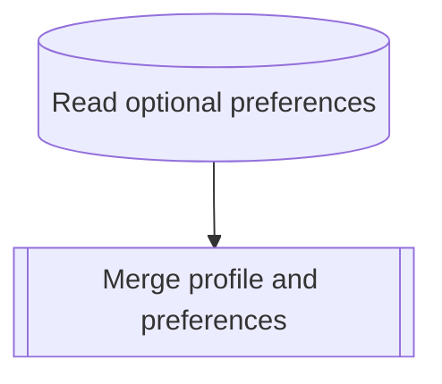

# Mermaid notation for precise diagrams

Use this reference to translate an action, condition, or relationship into standard Mermaid notation. Expanded `@{ shape: ... }` syntax requires Mermaid 11.3+. Protocol labels and the meaning assigned to line styles are authoring conventions, not additional Mermaid syntax.

## Blocks

Use `id@{ shape: NAME, label: "Action or condition" }`. Choose the shape by the operation being described, not by the type of data that happens to pass through it.

| Meaning                | Shape     | Label example                                |
| ---------------------- | --------- | -------------------------------------------- |
| Start / End            | `stadium` | `Start`, `Return User`, `Error: unavailable` |
| Process                | `rect`    | `Normalize address`                          |
| Decision               | `diam`    | `Record exists?`                             |
| Call / child function  | `subproc` | `Resolve delivery point`                     |
| HTTP API               | `subproc` | `HTTP GET /api/users/{id}`                   |
| gRPC                   | `subproc` | `gRPC UsersService/GetUser`                  |
| Database               | `cyl`     | `Read active zones from MySQL`               |
| Queue / message buffer | `h-cyl`   | `Publish order.created to Kafka`             |
| Input/output           | `lean-r`  | `Read input file`                            |
| Document               | `doc`     | `Generate invoice`                           |
| Multiple documents     | `docs`    | `Read batch of reports`                      |
| Preparation            | `hex`     | `Initialize retry counter`                   |
| Manual operation       | `trap-t`  | `Operator approves request`                  |
| Delay                  | `delay`   | `Wait until next retry`                      |
| Fork / join            | `fork`    | Label outgoing paths and any wait condition |
| Connector              | `circle`  | `A` (matching continuation, used sparingly)  |

HTTP and gRPC use the call shape with protocol plus method/path in the label. Separate a call from a decision about its result: “Fetch user” performs work; “User found?” selects a path. A call shape does not say whether the call blocks or runs in the background.

For a database action, name the read/write and relevant entity. “Filter loaded users” is a local process; “Query active users” accesses storage. For a queue, name whether the operation publishes, consumes, or waits. Using `h-cyl` for a queue is a convention for this guide; Mermaid's horizontal cylinder is a general storage shape.

Use an action label in an algorithm: “Generate invoice”. In a data-flow view the same document shape may represent the artifact “Invoice”; label the arrows with the data being passed. Establish which kind of flow the diagram expresses before mixing objects with actions.

Common classic equivalents are `start(["Start"])`, `step["Process"]`, `decision{"Condition?"}`, `call[["Call"]]`, `db[("Read users")]`, and `io[/"Input or output"/]`.

## Connections

Use directed solid arrows for ordinary control flow. Label branches and keep any special line convention consistent and explicit.

| Syntax | Use and limits |
| ------ | -------------- |
| `A --> B` | Next step in control flow; or data movement in a diagram explicitly about data flow. |
| `A -->\|"condition"\| B` | Conditional path; put the condition on the outgoing edge of a decision. |
| `A -.-> B` | Dotted arrow; can represent a notification or dependency when labeled accordingly. |
| `A -. "message" .-> B` | Labeled dotted arrow; the label supplies the meaning. |
| `A ==> B` | Thick arrow for emphasis; it does not grant priority or reliability. |
| `A --- B` | Undirected relationship, without implying execution order. |
| `A <--> B` | Two-way relationship; use separate labeled arrows or a sequence diagram if order matters. |
| `A --o B`, `A --x B` | Circle/cross markers; explain their meaning rather than assuming an error or cancellation. |
| `A ~~~ B` | Invisible positioning constraint; expresses no process relationship. |

Chained `A --> B --> C` and fan-out `A --> B & C` are valid. Separate edges are easier to label and edit. Multiple outgoing edges alone do not distinguish a choice from concurrency.

## Conditions, loops, and outcomes

A decision asks one clear question. For a binary condition, use complementary exits such as “yes” and “no”; for a switch, use explicit cases and a fallback when one exists. Merge alternative branches at a shared next step only when their subsequent behavior is the same. Such a merge does not wait for both alternatives.

The back-edge expresses repetition; taking the next item explains progress. For retries, show the actual retry condition and any specified delay or limit. Do not invent a retry policy when none is known. Failure can end the operation, trigger recovery, or propagate to a caller: draw the behavior that is being described, with a named outcome rather than an unexplained cross marker.

## Background work and concurrency

Use a fork when multiple paths begin, a decision when one path is selected. A detached task has its own end; the caller's end must not imply that the task has also finished.

This example describes a detached task, not a guarantee that it survives caller cancellation or process shutdown. Show those lifetime rules only if specified. For parallel work that the caller awaits, converge the worker paths at a `fork` join, label the outgoing edge “after both complete”, and continue from there. A normal merge must not silently stand for a synchronization barrier.

For queued work, separate “Publish job” from “Process job”. The publisher may continue after the queue accepts the message; that is not consumer completion. If both sides appear in one flowchart, a labeled dotted edge can represent message delivery and solid edges each participant's control flow. Explain that convention in a `%%` comment or visible note. A dotted line alone does not mean async, retries, or guaranteed delivery.

Use `subgraph` for responsibility or a phase, as in the worker above. A subgraph boundary alone says nothing about transactions, isolation, or parallelism. When transaction boundaries matter, show the relevant begin/commit/rollback steps and place side effects in their actual order.

## Labels and tooltips

Keep labels brief. Quote labels containing punctuation and use ` ` for intentional line breaks. `#quot;` escapes a literal double quote in Mermaid strings. Markdown labels such as ``A["`**Normalize** address`"]`` are optional; retain the existing style when editing.

This excerpt belongs beside `merge-profile.mmd`, as in the linked files in `../examples/`. Use a target that actually exists relative to the containing diagram.

For linked blocks the quoted string after the URL is the native Mermaid tooltip. For unlinked blocks an HTML `title` attribute provides a hint; `config.htmlLabels: true` requests HTML labels. Escape `&`, `<`, and apostrophes within a single-quoted title with `&amp;`, `&lt;`, and `&apos;`. Keep the hint short and use it for secondary information such as lookup criteria or field meanings.

HTML titles and click interactions require support from the application displaying the diagram. Keep actions, decisions, failures, and completion conditions visible in the diagram itself. No custom `tooltip` property, fake URL, or JavaScript callback is needed.

## Child diagrams

Split out a cohesive operation when its internals distract from the parent's purpose or it is reused. Keep the call and relevant handling of its result in the parent; put the detailed algorithm in the child. A parent should remain understandable without opening every child.

Give each diagram a meaningful file name and title. A call in `orders/create.mmd` can use `click reserve href "../stock/reserve.mmd" "Reserve the requested quantity"`; resolve it from `orders/`, not the workspace root. Use `./child.mmd` for a sibling. Update inbound references when moving a file.

A link expresses where to find more detail. The flow around the call expresses whether the caller waits, continues independently, or handles a failure. A child outcome need not link back to every caller; model each caller's continuation in its own diagram. Several callers can share one child without copying its internals.

## Other diagram types

Use `sequenceDiagram` when who sends what to whom, and in what order, is the main question: `alt` selects alternatives, `opt` encloses an optional interaction, `loop` repeats, and `par` describes concurrent interactions. Use `stateDiagram-v2` when events move an entity between legal states; use `erDiagram` for entities and relationship cardinalities. Their grammars differ: do not transplant flowchart shapes or `click` statements into them.

References: [flowcharts, shapes, edges, interaction](https://mermaid.js.org/syntax/flowchart.html), [sequence diagrams](https://mermaid.js.org/syntax/sequenceDiagram.html), [state diagrams](https://mermaid.js.org/syntax/stateDiagram.html), [ER diagrams](https://mermaid.js.org/syntax/entityRelationshipDiagram.html).
